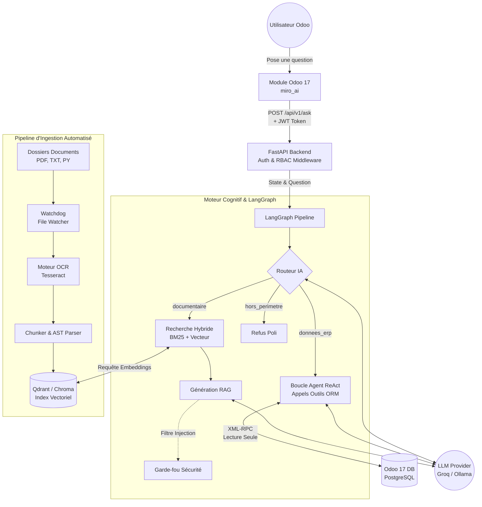

# Architecture du Système MIRO RAG

Ce document décrit l'architecture technique complète de la plateforme **MIRO RAG**, développée pour intégrer un Assistant IA avancé directement dans Odoo 17, couplant recherche documentaire vectorielle (RAG) et orchestration d'appels à la base de données (Agent ORM ReAct).

---

## 1. Vue d'Ensemble de l'Architecture (High-Level)

Le système MIRO RAG s'articule autour de 4 couches majeures :
1. **L'Interface Odoo (Client)** : Le module `miro_ai` installé sur Odoo 17 qui fournit le chat utilisateur et s'occupe de l'authentification (JWT).
2. **Le Backend API (FastAPI)** : L'orchestrateur sécurisé qui reçoit les requêtes, gère les permissions RBAC et loggue la télémétrie.
3. **Le Moteur Cognitif (LangGraph + LLM)** : Le cerveau du système qui route la question, effectue de la recherche hybride (BM25 + Vecteur), ou déclenche la boucle de raisonnement ReAct pour interagir avec les outils Odoo.
4. **La Couche Données (Vectorstore & Ingestion)** : Qdrant/Chroma pour les vecteurs, le système de fichiers surveillé par Watchdog, et le moteur OCR pour les PDF scannés.

### Diagramme d'Architecture Globale



---

## 2. Description des Composants Clés

### 2.1 Le Routeur IA (LangGraph)
C'est la première étape du pipeline LangGraph. Son rôle est de lire la question de l'utilisateur (avec son historique de conversation) et de décider de la branche à activer.
- **Routage conditionnel :** Il détecte l'intention via des heuristiques et un appel LLM. Si la question évoque des noms de clients, des montants financiers, des stocks ou des tickets, le routeur déclenche la branche **Données ERP**. Si la question porte sur des règles RH, des manuels d'utilisation ou l'architecture logicielle, il déclenche la branche **Documentaire**.
- **Sécurité Fast-Fail :** Le routeur intègre un mécanisme `_is_out_of_scope` qui bloque immédiatement les requêtes non pertinentes (ex: « Donne-moi une recette de cuisine »).

### 2.2 La Branche RAG (Documentaire)
- **Recherche Hybride :** Utilise à la fois BM25 (Recherche par mot-clé exacte) et les embeddings vectoriels (`nomic-embed-text-v1.5`) pour interroger Qdrant ou ChromaDB.
- **Reranking & Context Recall :** Les résultats sont combinés (Ensemble Retriever) pour s'assurer que les documents techniques, les procédures RH et le code source (`__manifest__.py`) remontent correctement.
- **Génération (ChatGroq) :** Le LLM utilise le contexte récupéré pour rédiger une réponse sourcée et formater la sortie structurée (via `with_structured_output(LLMResponse)`).

### 2.3 L'Agent ORM ReAct (Données ERP)
- **Modèle ReAct :** L'agent utilise le LLM `llama-3.1-8b-instant` équipé de la fonction `bind_tools()`. Il réfléchit, choisit un outil, observe le résultat, et itère jusqu'à trouver la bonne réponse (limité à 6 récursions).
- **Outils ORM (`tools/odoo_tools.py`) :** Une collection de fonctions Python agissant comme passerelles XML-RPC vers Odoo.
- **Isolation d'Identité (UID Passthrough) :** Chaque outil utilise le `uid` de l'utilisateur demandeur (via un contexte `contextvars`). L'agent ne peut récupérer **que** ce que l'utilisateur a le droit de voir dans Odoo (Application stricte de `ir.rule`).
- **Read-Only Enforced :** Tous les appels sont restreints aux méthodes `search_read`, `read_group` et `fields_get`. Aucune modification (`write`, `create`, `unlink`) n'est autorisée.

### 2.4 Le Pipeline d'Ingestion (Watcher & Indexing)
- **Watchdog :** Surveille continuellement (en tâche de fond) le système de fichiers (`fake_data/docs/`). 
- **Incrémentiel :** Si un fichier est ajouté ou modifié, seul ce fichier est découpé, encodé et mis à jour dans la base vectorielle. Les fichiers non modifiés sont ignorés grâce à un calcul de Hash (`MD5`).
- **OCR Intégré :** Les fichiers PDF scannés passent automatiquement par `pytesseract` (Tesseract OCR) pour extraire le texte avant chunking.

### 2.5 Multi-Tenant & RBAC (Sécurité Avancée)
L'architecture garantit l'étanchéité absolue des données dans un environnement multi-sociétés (Multi-Tenant).
- **Qdrant Multi-Collection :** Chaque société Odoo possède sa propre "Collection" vectorielle dédiée. L'API extrait le `company_id` du JWT et dirige la recherche vectorielle uniquement vers la collection de cette entreprise.
- **RBAC (Role-Based Access Control) :** Les outils mis à disposition de l'Agent ReAct sont filtrés par les groupes de sécurité Odoo de l'utilisateur. Un utilisateur sans droits "Ventes" ne se verra pas attacher l'outil `obtenir_total_ventes` à son instance LLM.

---

## 3. Transition Codespaces → Production (Ollama)

L'architecture est "Agnostique du LLM" (LLM-Agnostic). Actuellement testé sur Groq (`llama-3.1-8b-instant`), le système est conçu pour être basculé vers une infrastructure On-Premise (Ollama) chez MiroKE en modifiant simplement le fichier `config/settings.py` :

```python
# config/settings.py
LLM_PROVIDER = "ollama"  # Changement d'une seule ligne
OLLAMA_BASE_URL = "http://localhost:11434"
OLLAMA_MODEL = "llama3.1:8b"
```

Cette flexibilité garantit que **100% des requêtes et des données de l'entreprise restent en local**, sans dépendance au cloud externe.

---
**Document créé pour MIRO RAG - Phase 5 (Step 17 Day 1)**
