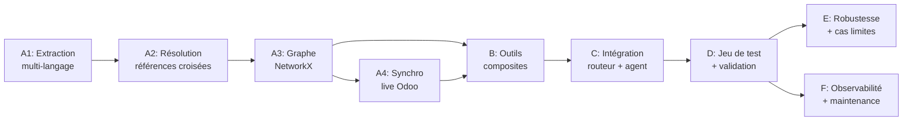

# Backlog — Agent de Code Intelligence (Odoo)

> **Source de vérité** : [plan_agent_code_intelligence_fusionne(2).md](file:///home/user/odoo-ia-prototype/todo/plan_agent_code_intelligence_fusionne%282%29.md)
> **Généré** : 2026-07-23
> **Méthode** : Agile — Epics → User Stories → Tasks — avec critères d'acceptation

---

## Décisions techniques prises avant implémentation


### DT-1 : Arbitrage inter-branches → DIFFÉRÉ

**Décision** : Différé. Traité au plus tôt en Sprint C, une fois la branche Code Intelligence fonctionnelle.

**Justification** : Le document [arbitrage_rag_function_calling_code_intelligence.md](file:///home/user/odoo-ia-prototype/todo/arbitrage_rag_function_calling_code_intelligence.md) pose 5 axes de décision ouverts, dont aucun n'a de réponse arrêtée. Or, tous ces axes présupposent une branche Code Intelligence *qui fonctionne* — on ne peut pas arbitrer entre RAG et CI si CI n'existe pas encore. Le faire maintenant serait du design spéculatif sur une branche mouvante.

**Conséquence** : Sprint C se concentre sur le branchement de `code_intelligence_agent_loop` dans le graphe existant ([graph.py](file:///home/user/odoo-ia-prototype/miro-rag/rag/graph.py)) avec un 4ème route `CODE_INTELLIGENCE` dans le [QueryRoute](file:///home/user/odoo-ia-prototype/miro-rag/rag/schemas.py#L14-L18) enum. L'arbitrage (quand RAG et CI divergent, séquençage multi-branche, adaptation au profil utilisateur) est reporté à un sprint dédié post-D.

### DT-3 : `domain_force` — stockage brut d'abord, parsing structuré si nécessaire

**Décision** : Stocker `domain_force` comme **attribut texte brut** sur le nœud `Rule`. Le parsing structuré (opérateurs `|`/`&`, résolution de `ref()`, évaluation de `[(1,'=',1)]`) ne sera implémenté **que si** un outil composite en a besoin concrètement (vraisemblablement `qui_a_acces_a` ou `comparer_regles_statique_vs_live`).

**Justification** : Les domain expressions Odoo sont un mini-langage à part entière. Un parser complet coûterait 2-3 jours et pourrait ne jamais être exercé si les outils composites n'ont besoin que de savoir *qu'une règle existe* plutôt que de l'*évaluer*. On parie sur YAGNI et on itère si nécessaire.

### DT-4 : Sérialisation du graphe → `node_link_data` JSON

**Décision** : Utiliser `networkx.node_link_data()` / `node_link_graph()` avec sérialisation **JSON**, pas GraphML.

**Justification** : GraphML ne préserve pas nativement les attributs Python complexes (listes, dicts, domaines parsés). JSON via `node_link_data` :
- Préserve tous les types d'attributs nativement
- Reste inspectable manuellement (fichier JSON lisible)
- Est portable et versionnable (diff lisible)
- Pas de convention de sérialisation ad-hoc à inventer

Le fichier sera sauvegardé en `.json` avec pretty-print pour l'inspectabilité.

### DT-5 : Routeur unique — `graph.py`

**Décision** : Le routeur canonique est [graph.py](file:///home/user/odoo-ia-prototype/miro-rag/rag/graph.py) (l. 544-572). Il n'y a pas de `hybrid_router.py` séparé dans le codebase actuel. Le `QueryRoute` enum dans [schemas.py](file:///home/user/odoo-ia-prototype/miro-rag/rag/schemas.py#L14-L18) sera étendu avec `CODE_INTELLIGENCE = "code_intelligence"` en Sprint C.

Le graphe LangGraph actuel est :
```
retrieve → route → [documentaire]  → generate      → format_output → END
                 → [donnees_erp]   → orm_agent_loop → format_output → END
                 → [hybride]       → hybrid_node    → format_output → END
```

Deviendra :
```
retrieve → route → [documentaire]      → generate                      → format_output → END
                 → [donnees_erp]       → orm_agent_loop                → format_output → END
                 → [hybride]           → hybrid_node                   → format_output → END
                 → [code_intelligence] → code_intelligence_agent_loop  → format_output → END
```

---

## Epic A — Fondation : Index structurel complet du code

### A1 — Extraction structurelle multi-langage

---

#### Story A1.1 : Extraction Python — `jedi` + AST Odoo

> *En tant qu'agent, je veux un index structurel complet de chaque fichier Python Odoo du corpus, pour pouvoir construire un graphe navigable de modèles/champs/méthodes.*

**Tasks :**

| ID | Tâche | Description | Critère d'acceptation | Dépend de |
|---|---|---|---|---|
| A1.1.1 | Intégrer `jedi` | Ajouter `jedi` à `requirements.txt`. Tester résolution de définitions/références Python standard sur le corpus réel. Documenter les limites de `jedi` sur les patterns Odoo (prédiction : `self.env['model']`, `_inherit` magic, `fields.Xxx('comodel')` comme string → `jedi` échoue sur tous). | `jedi` résout correctement les imports standard et les définitions de classes Python classiques. Liste documentée de ce que `jedi` ne couvre PAS. | — |
| A1.1.2 | Visiteur AST : `_inherit` / `_name` / `_inherits` | Visiteur `ast.NodeVisitor` dédié qui distingue : (1) **extension** (`_inherit` seul, sans `_name`) → type d'arête `EXTENDS`, (2) **héritage classique** (`_name` + `_inherit`) → type d'arête `EXTENDS` + nouveau nœud `Model`, (3) **délégation** (`_inherits` avec "s") → type d'arête `DELEGATES_TO`. | Test unitaire : 3 fichiers de test, un par cas, résultat correct pour chaque. | A1.1.1 |
| A1.1.3 | Visiteur AST : décorateurs `@api.depends/constrains/onchange` | Extraire décorateur + **liste exacte des champs déclencheurs** passés en arguments, y compris chemins pointés (ex: `@api.depends('partner_id.name', 'line_ids.price_total')`). | Test unitaire : champs déclencheurs simples et chemins pointés extraits correctement. | A1.1.1 |
| A1.1.4 | Visiteur AST : champs relationnels | Extraire `fields.Many2one/One2many/Many2many` avec : `comodel_name` (1er arg positionnel ou kwarg), `inverse_name` (One2many), `related` (champ calculé par délégation de chemin), `compute` (nom de la méthode), `store` (booléen). | Test unitaire : chaque type de champ avec chaque attribut extractible. | A1.1.1 |
| A1.1.5 | Visiteur AST : contexte de méthode | Détecter `@api.model`, `@api.model_create_multi` vs méthode d'instance. Stocker comme attribut du nœud `Method`. | Test unitaire : distinction correcte model/instance sur 3 méthodes de test. | A1.1.1 |
| A1.1.6 | Parser `__manifest__.py` | Parser chaque `__manifest__.py` : extraire `depends` (ordre de chargement) et `data` (fichiers XML/CSV chargés — un fichier présent dans le dossier mais absent de `data` n'est jamais chargé). | Test unitaire : manifest réel parsé, `depends` et `data` extraits correctement. Fichier absent de `data` signalé. | — |
| A1.1.7 | Tests d'intégration A1.1 | Exécuter l'ensemble des extracteurs Python sur un module réel complet du corpus. Vérifier couverture (% de classes/méthodes/champs correctement extraits). | ≥ 90% de couverture sur le module test. Rapport de couverture documenté. | A1.1.2 → A1.1.6 |

---

#### Story A1.2 : Extraction XML — extension tree-sitter

> *En tant qu'agent, je veux extraire les règles de sécurité, groupes, actions et vues depuis les fichiers XML Odoo, pour compléter le graphe avec la couche droits d'accès et navigation UI.*

**Tasks :**

| ID | Tâche | Description | Critère d'acceptation | Dépend de |
|---|---|---|---|---|
| A1.2.1 | Parser `ir.rule` | `<record model="ir.rule">` → extraire `domain_force` (**texte brut**, cf. DT-3), `groups_id` (many2many vers `res.groups`), `model_id`, et `perm_read/write/create/unlink` **distincts**. | Test unitaire : règle avec `perm_read=1, perm_write=0` correctement distinguée. `domain_force` stocké comme string. | — |
| A1.2.2 | Parser `res.groups` | `<record model="res.groups">` → `implied_ids` (hiérarchie transitive), `category_id` (catégorie fonctionnelle). | Test unitaire : hiérarchie `implied_ids` extraite comme relation orientée. | — |
| A1.2.3 | Parser `ir.actions.act_window` | Permissions `groups_id` directement sur l'action (distinct des règles au niveau modèle). | Test unitaire : action avec `groups_id` restrictif correctement extraite. | — |
| A1.2.4 | Parser `ir.model.fields` XML + `<menuitem>` | Champs définis dynamiquement en XML + `<menuitem>` avec leur `groups` (visibilité de menu). | Test unitaire : menuitem avec groups correctement extrait. | — |
| A1.2.5 | Parser vues formulaire (`arch` de `ir.ui.view`) | Extraire labels de boutons de transition (`<button name="action_confirm" string="Confirmer"/>`) et chemin de menu complet (parent → enfant `<menuitem>`). | Test unitaire : bouton "Confirmer" avec son `name` et `string` extraits. Chemin de menu reconstitué. | A1.2.4 |
| A1.2.6 | Tests d'intégration A1.2 | Exécuter tous les parseurs XML sur un module réel avec `ir.rule`, `res.groups`, vues, actions, menus. | Toutes les entités XML d'un module réel correctement extraites. | A1.2.1 → A1.2.5 |

---


#### Story A1.3 : Extraction CSV — `ir.model.access.csv`

> *En tant qu'agent, je veux parser les fichiers d'ACL CSV d'Odoo, y compris le cas critique du `group_id` vide.*

**Tasks :**

| ID | Tâche | Description | Critère d'acceptation | Dépend de |
|---|---|---|---|---|
| A1.3.1 | Parser CSV structuré | Parser `ir.model.access.csv` : `id, name, model_id:id, group_id:id, perm_read, perm_write, perm_create, perm_unlink`. | Parsing correct de toutes les lignes d'un fichier réel. | — |
| A1.3.2 | Gestion `group_id` vide | `group_id` **vide** = règle pour **tous les utilisateurs authentifiés**, pas une ligne invalide à exclure. | Test unitaire dédié : ligne avec `group_id` vide crée un nœud `AccessEntry` avec attribut `all_authenticated=True`. | A1.3.1 |

---

#### Story A1.4 : Extraction JS — contrôles côté client

> *En tant qu'agent, je veux détecter les contrôles de droits côté client JS/OWL, en sachant qu'ils ne sont jamais une garantie de sécurité.*

**Tasks :**

| ID | Tâche | Description | Critère d'acceptation | Dépend de |
|---|---|---|---|---|
| A1.4.1 | Extraction `hasGroup` + patterns OWL | Détecter `this.env.user.hasGroup(...)`, `useService("user")` + `t-if="user.hasGroup(...)"`. Stocker avec attribut `client_side_only=True`. | Test unitaire : 2 patterns détectés. Attribut `client_side_only` présent. | — |
| A1.4.2 | Test d'intégration bout en bout A1 | Exécuter tous les extracteurs (Python + XML + CSV + JS) sur un module réel complet. Bilan de fin de sprint A1. | Un module entier (ex: `sale`, `hr_holidays`) produit une sortie structurée complète sans erreur. | A1.1.7, A1.2.6, A1.3.2, A1.4.1 |

---

### A2 — Résolution des références croisées inter-fichiers

#### Story A2.1 : Résolution en deux passes

> *En tant qu'agent, je veux que toutes les références croisées (groupe mentionné dans une règle, modèle hérité depuis un autre module) soient résolues selon l'ordre de chargement réel d'Odoo.*

**Tasks :**

| ID | Tâche | Description | Critère d'acceptation | Dépend de |
|---|---|---|---|---|
| A2.1.1 | Passe 1 : indexation des symboles | Indexer tous les symboles définis (par module), avec ordre de chargement issu des manifests (dépend de A1.1.6). | Registre de symboles construit, ordonné par dépendances de modules. | A1.1.6 |
| A2.1.2 | Passe 2 : résolution ordonnée | Résoudre les références selon l'ordre de chargement réel, pas selon l'ordre d'apparition dans le corpus. | Test : référence à un groupe défini dans un module chargé *après* dans l'ordre du corpus mais *avant* dans l'ordre des `depends` → résolu correctement. | A2.1.1 |
| A2.1.3 | Registre des non-résolus catégorisé | Catégoriser les références non résolues : (1) symbole absent du corpus, (2) symbole du cœur Odoo hors périmètre indexé, (3) erreur de frappe probable. | Registre produit. Chaque entrée a une catégorie. Test avec un XML-ID volontairement mal écrit → catégorie "erreur probable". | A2.1.2 |
| A2.1.4 | Détection de cycles | `visited: set()` dès la première implémentation du résolveur. Test avec un cycle d'héritage artificiel injecté. | Cycle détecté sans boucle infinie. Message d'erreur explicite. | A2.1.2 |
| A2.1.5 | Test d'intégration A1+A2 | Exécuter extraction (A1) puis résolution (A2) sur le corpus réel complet. Bilan. | Graphe brut (avant stockage NetworkX) navigable sur les relations inter-modules. Registre des non-résolus examiné et jugé acceptable. | A2.1.1 → A2.1.4 |

---

### A3 — Stockage : graphe NetworkX complet

#### Story A3.1 : Schéma de graphe + construction NetworkX

> *En tant qu'agent, je veux un graphe NetworkX typé avec des nœuds et arêtes explicitement typés, navigable en code Python déterministe.*

**Schéma de graphe (document de design à valider avant tout code) :**

```
Types de nœuds : Model, Field, Method, Group, Rule, Module, AccessEntry, WorkflowState

Types d'arêtes (typées, pas génériques) :
  EXTENDS          (Model → Model, via _inherit)
  DELEGATES_TO     (Model → Model, via _inherits)
  HAS_FIELD        (Model → Field)
  RELATES_TO       (Field → Model, via comodel_name, attr: relation_type)
  COMPUTED_BY       (Field → Method)
  DEPENDS_ON       (Method → Field, via @api.depends)
  RESTRICTED_BY    (Model → Rule)
  APPLIES_TO_GROUP (Rule → Group)
  IMPLIES          (Group → Group, hiérarchie transitive)
  GRANTED_BY       (Model → AccessEntry)
  DEFINED_IN       (tout nœud → Module, attr: filepath, lineno)
  TRANSITIONS_VIA  (WorkflowState → Method → WorkflowState, attr: label_bouton, groupe_requis)
```

**Tasks :**

| ID | Tâche | Description | Critère d'acceptation | Dépend de |
|---|---|---|---|---|
| A3.1.1 | Document de design du schéma | Formaliser le schéma (nœuds, arêtes, attributs) comme document validé avant implémentation. | Document écrit, relu, validé (même si auto-validé — l'important est qu'il existe avant le code). | — |
| A3.1.2 | Construction NetworkX — nœuds principaux | Construire le graphe à partir des sorties A1/A2 : nœuds `Model`, `Field`, `Method`, `Group`, `Rule`, `Module`, `AccessEntry`. | Graphe construit. Chaque nœud a un type et des attributs. `G.nodes(data=True)` retourne les attributs attendus. | A2.1.5 |
| A3.1.3 | Construction NetworkX — arêtes typées | Arêtes `EXTENDS`, `DELEGATES_TO`, `HAS_FIELD`, `RELATES_TO`, `COMPUTED_BY`, `DEPENDS_ON`, `RESTRICTED_BY`, `APPLIES_TO_GROUP`, `IMPLIES`, `GRANTED_BY`, `DEFINED_IN`. | Chaque arête a un attribut `edge_type`. Traversée typée fonctionne : `[(u,v) for u,v,d in G.edges(data=True) if d['edge_type'] == 'RESTRICTED_BY']`. | A3.1.2 |
| A3.1.4 | Sérialisation JSON (`node_link_data`) | Sérialisation via `networkx.node_link_data()` en JSON pretty-printed. Désérialisation via `node_link_graph()`. Cf. DT-4. | Cycle save → load → save produit le même fichier. Fichier JSON inspectable manuellement. | A3.1.3 |
| A3.1.5 | Sous-graphe Workflow | Nœuds `WorkflowState` (champ `state = fields.Selection([...])`) + arêtes `TRANSITIONS_VIA` (méthodes de transition) avec attributs : `groupe_requis`, `seuil_conditionnel`, `label_bouton`, `chemin_menu`. | Test : modèle `hr.leave` (ou équivalent) → états `draft → confirm → validate1 → validate → refuse` navigables dans le graphe, avec boutons et groupes. | A3.1.3, A1.2.5 |
| A3.1.6 | Benchmark de traversée | Mesurer le temps de traversée à 5 sauts sur le volume réel du corpus. Comparer à un budget de latence cible (ex: < 50ms pour 5 sauts). | Benchmark exécuté. Résultat documenté. Si > budget, documenter les options d'optimisation. | A3.1.5 |
| A3.1.7 | Bilan de fin Sprint A (A1-A3) | Graphe complet (sécurité statique + workflow) navigable en NetworkX sur le corpus réel. | Démonstration : traversée `Model → RESTRICTED_BY → Rule → APPLIES_TO_GROUP → Group → IMPLIES → Group` sur un modèle réel du corpus. | A3.1.6 |

---

### A4 — Synchronisation avec le contenu réel Odoo (live)

#### Story A4.1 : Connexion live et détection de divergence

> *En tant qu'agent, je veux comparer le graphe statique (issu du code) avec les droits réellement actifs en base Odoo, pour détecter les divergences.*

**Tasks :**

| ID | Tâche | Description | Critère d'acceptation | Dépend de |
|---|---|---|---|---|
| A4.1.1 | Requêtes XML-RPC live | Connexion XML-RPC (réutiliser le pattern de [odoo_connector.py](file:///home/user/odoo-ia-prototype/miro-rag/tools/odoo_connector.py)). Requêtes sur `ir.model.access`, `ir.rule`, `res.groups`. Mesure du coût réel par appel. | Connexion fonctionnelle. Données récupérées. Latence mesurée (~100-300ms attendu). | A3.1.7 |
| A4.1.2 | Cache TTL | Cache 5 minutes avec invalidation manuelle. Appel dupliqué avec même arguments → résultat du cache, pas un nouvel appel XML-RPC. | Test : 2 appels identiques en < 5min → 1 seul appel XML-RPC. Invalidation manuelle → nouvel appel. | A4.1.1 |
| A4.1.3 | Logique de divergence détaillée | `comparer_regles_statique_vs_live` retourne la **nature précise** de la divergence : groupe ajouté en base mais absent du code, domaine modifié (avec les deux valeurs côte à côte), règle `active: False` en base mais présente dans le XML. **Jamais un booléen.** | Test : 3 types de divergence volontairement introduits en base → chacun détecté avec le bon type et les bonnes valeurs. | A4.1.1 |
| A4.1.4 | Tests d'intégration A1-A4 | Bout en bout sur le corpus réel + instance Odoo live. Bilan de fin Sprint A complet. | Pipeline complète fonctionnelle : extraction → résolution → graphe → comparaison live. | A4.1.3 |

---

## Epic B — Outils composites

### Story B.1 : Les 5 outils composites

> *En tant qu'agent LLM, je veux pouvoir répondre à une question de gouvernance/processus en un seul appel d'outil, sans orchestrer moi-même la traversée du graphe.*

**Tasks :**

| ID | Tâche | Description | Critère d'acceptation | Dépend de |
|---|---|---|---|---|
| B.1.1 | `qui_a_acces_a(modele, action)` | Traversée règles → groupes → hiérarchie → rôles métier en une fois. Retourne les rôles ayant accès. | Test : `qui_a_acces_a("account.move", "write")` retourne les groupes/rôles corrects du graphe réel. | A3.1.7 |
| B.1.2 | `modules_et_regles_dun_modele(modele)` | Modules qui étendent un modèle + ses règles de sécurité. | Test : modèle étendu par 3 modules → les 3 retournés avec leurs règles respectives. | A3.1.7 |
| B.1.3 | `comparer_regles_statique_vs_live(modele)` | Wrapper autour de la logique A4.1.3, exposé comme outil LangChain `@tool`. | Test : divergence détectée et formatée en sortie structurée. | A4.1.3 |
| B.1.4 | `suivre_heritage_complet(modele)` | Chaîne d'héritage complète, `_inherit` ET `_inherits` distingués. Délégation toujours incluse (pas de paramètre séparé). | Test : modèle avec héritage + délégation → les deux chaînes retournées avec distinction de type. | A3.1.7 |
| B.1.5 | `quel_est_le_processus_de(modele)` | Traverse `WorkflowState → TRANSITIONS_VIA → WorkflowState`. Retourne séquence d'étapes avec : méthode, groupe/rôle requis, label du bouton, chemin de menu. | Test : `quel_est_le_processus_de("hr.leave")` retourne les étapes du processus de congé avec boutons et rôles. | A3.1.5 |
| B.1.6 | Gestion d'erreur à 3 niveaux | Chaque outil composite gère : (1) résultat trouvé, (2) résultat vide (symbole existe, rien trouvé), (3) symbole introuvable (erreur de nom probable). Message distinct pour chaque cas. | Tests unitaires : 3 cas × 5 outils = 15 tests. Chaque message distinct et non-ambigu. | B.1.1 → B.1.5 |

---

### Story B.2 : Outils annexes

> *En tant qu'agent, je veux des outils utilitaires pour le scoping, la traduction technique→humain, et la lecture de code source ciblée.*

**Tasks :**

| ID | Tâche | Description | Critère d'acceptation | Dépend de |
|---|---|---|---|---|
| B.2.1 | `resoudre_nom_technique_vers_role(nom)` | Table de correspondance technique → rôle métier MiroKE. | Test : `"group_hr_manager"` → `"Responsable RH"`. | — |
| B.2.2 | `lister_modules_impliques(modele)` | Scoping en amont d'une question complexe. | Test : modèle étendu par N modules → N modules listés. | A3.1.7 |
| B.2.3 | `expliquer_chemin_de_decision(chemin)` | Reformule une séquence de nœuds/arêtes en langage naturel étape par étape. | Test : chemin `[Model → Rule → Group → Group]` → explication lisible. | — |
| B.2.4 | `lire_code_source_precis(fichier, debut, fin)` | Lecture ciblée avec garde-fou sur la taille max de plage (ex: 200 lignes max). | Test : plage > 200 lignes → refus avec message explicite. Plage valide → code retourné. | — |
| B.2.5 | Tests complets Sprint B | Tests unitaires complets sur les 5 composites + 4 annexes. Bilan. | 100% des tests passent. Chaque outil documenté avec exemples d'appel et de sortie. | B.1.6, B.2.1 → B.2.4 |

---

## Epic C — Intégration routeur et agent

### Story C.1 : Boucle agent Code Intelligence

> *En tant que système, je veux une boucle agent dédiée au Code Intelligence, intégrée dans le graphe LangGraph existant.*

**Tasks :**

| ID | Tâche | Description | Critère d'acceptation | Dépend de |
|---|---|---|---|---|
| C.1.1 | `code_intelligence_agent_loop` | Boucle LangGraph ReAct conçue pour 1-2 itérations max par question. Les 5 outils composites + 4 annexes sont bindés. | Boucle fonctionnelle. Question simple → 1 appel d'outil → réponse. | B.2.5 |
| C.1.2 | Garde-fou anti-boucle | Détection de rappel identique outil + arguments. Porter le pattern déjà existant dans [graph.py](file:///home/user/odoo-ia-prototype/miro-rag/rag/graph.py) (ORM agent loop). | Test : appel dupliqué → interception propre, pas de boucle infinie. | C.1.1 |
| C.1.3 | Prompt système CI | Stratégie de navigation explicite : toujours commencer par `lister_modules_impliques` pour scoper, puis comparer statique avant live. | Prompt écrit. Test : question de gouvernance → l'agent scope avant de traverser. | C.1.1 |
| C.1.4 | Compteur de sauts | Compteur dans le state LangGraph. Indique précisément à quel saut l'agent s'est arrêté en cas de réponse partielle. | Test : réponse partielle (limite atteinte) → message explicite "arrêté au saut N/max". | C.1.1 |
| C.1.5 | Branchement dans `graph.py` | Ajouter `CODE_INTELLIGENCE` au `QueryRoute` enum. Ajouter le nœud `code_intelligence_agent_loop` au graphe. Ajouter les keywords de routing CI au routeur. | Le graphe compile. Question CI → routed vers le bon nœud → réponse. | C.1.1 → C.1.4 |
| C.1.6 | Tests d'intégration Sprint C | Quelques questions représentatives bout en bout (gouvernance, processus, héritage). | ≥ 3 questions correctement routées et répondues. | C.1.5 |

---

## Epic D — Jeu de test et validation

### Story D.1 : Construction du jeu de test

> *En tant que stagiaire, je veux un jeu de test structuré pour mesurer la performance de l'agent et alimenter le mémoire.*

**Tasks :**

| ID | Tâche | Description | Critère d'acceptation | Dépend de |
|---|---|---|---|---|
| D.1.1 | Grille de répartition | Matrice : (1 saut / 2-3 sauts / 4+ sauts) × (sécurité pure / logique métier calculée / mapping technique→humain). | Grille documentée avec le nombre cible de questions par cellule. | — |
| D.1.2 | Rédaction des questions + réponses attendues | Avec le maître de stage. Chaque question a une réponse attendue documentée. | ≥ 20 questions rédigées avec réponses attendues. | D.1.1 |
| D.1.3 | Questions pièges | "Information non trouvable dans le périmètre indexé" — proportion notable (≥ 20% du jeu). | ≥ 5 questions pièges avec comportement attendu documenté (chaque = test du cas `trouve: False`). | D.1.1 |
| D.1.4 | Harness de test automatisé | Script d'exécution automatisée : questions → agent → capture réponses + traversées internes. | Script exécutable. Sortie = rapport structuré (question, réponse, traversée, temps). | C.1.6 |

---

### Story D.2 : Exécution et évaluation

**Tasks :**

| ID | Tâche | Description | Critère d'acceptation | Dépend de |
|---|---|---|---|---|
| D.2.1 | Instrumentation logging traversée | Logger nœuds/arêtes visités par appel composite (pas seulement l'appel LLM). | Chaque exécution produit un log structuré de la traversée interne. | C.1.1 |
| D.2.2 | Exécution du jeu de test | Run complet, collecte des résultats. | Résultats collectés pour toutes les questions. | D.1.4, D.2.1 |
| D.2.3 | Grille de notation chemin de raisonnement | Chemin minimal réel vs détour valide vs nœud non pertinent visité. Notation par question. | Grille remplie. Score agrégé + score par cellule de la matrice. | D.2.2 |
| D.2.4 | Analyse faux positifs / vrais positifs | Taux de faux positifs (chemin halluciné) et vrais positifs sur les questions pièges, mesurés séparément. | Rapport avec les deux taux. Analyse des cas de faux positifs. | D.2.2 |
| D.2.5 | Rapport consolidé | Rapport final Sprint D pour le mémoire. | Document structuré avec résultats, graphiques, analyse. | D.2.3, D.2.4 |

---

## Epic E — Robustesse et cas limites

### Story E.1 : Hardening

**Tasks :**

| ID | Tâche | Description | Critère d'acceptation | Dépend de |
|---|---|---|---|---|
| E.1.1 | Non-régression cycles d'héritage | Test avec cycle artificiel injecté dans le corpus. Vérifier que la détection A2 tient. | Cycle détecté sans crash. | A2.1.4 |
| E.1.2 | Désambiguïsation symboles | Symboles ambigus → présenter candidats multiples avec module d'origine. Agent (ou utilisateur) tranche. | Test : symbole ambigu → liste de candidats présentée. | C.1.6 |
| E.1.3 | Budget de latence | 90ᵉ percentile sous X secondes pour navigation 3 sauts + 1 appel XML-RPC. Chiffre cible fixé. | Benchmark exécuté. Comparaison au chiffre cible. | D.2.2 |
| E.1.4 | Test d'injection / extraction massive | Requête "liste-moi toutes les règles de tous les modèles" → rate-limiting ou refus. | Test : requête massive → refus explicite avec message. | C.1.6 |

---

## Epic F — Observabilité et maintenance

### Story F.1 : Logging, staleness, budget

**Tasks :**

| ID | Tâche | Description | Critère d'acceptation | Dépend de |
|---|---|---|---|---|
| F.1.1 | Logging structuré production | Un appel composite = un log avec la traversée interne (pas 4-5 appels fins à corréler). | Logs lisibles. Chaque question → 1 entrée de log avec nœuds/arêtes visités. | D.2.1 |
| F.1.2 | Détection staleness de l'index | Réutiliser le mécanisme de hash SHA-256 de [incremental.py](file:///home/user/odoo-ia-prototype/miro-rag/ingestion/incremental.py), étendu au graphe structurel. | Modification d'un fichier source → sous-graphe à recalculer identifié. | A3.1.4 |
| F.1.3 | Recalcul incrémental du sous-graphe | Modification ciblée → recalcul du sous-graphe affecté seulement (pas tout le graphe). | Test : modification d'un fichier → seul le sous-graphe de ce module recalculé. Benchmark avant/après. | F.1.2 |
| F.1.4 | Plafond coût/latence par question | Chiffrage budget global. Plafond de sauts/appels par question comme garde-fou budgétaire. | Plafond configuré. Test : dépassement → arrêt propre avec réponse partielle. | E.1.3 |
| F.1.5 | Bilan final A1 → F | Revue générale. Checklist avant intégration production. | Checklist écrite et validée. | F.1.4 |

---

## Diagramme de dépendances entre Epics



---

## Résumé de volumétrie

| Epic | Stories | Tasks | Dépend de |
|---|---|---|---|
| A1 — Extraction | 4 | 17 | — |
| A2 — Résolution | 1 | 5 | A1 |
| A3 — Graphe | 1 | 7 | A2 |
| A4 — Live sync | 1 | 4 | A3 |
| B — Outils composites | 2 | 11 | A3, A4 |
| C — Intégration agent | 1 | 6 | B |
| D — Validation | 2 | 9 | C |
| E — Robustesse | 1 | 4 | D |
| F — Observabilité | 1 | 5 | D |
| **Total** | **14** | **68** | |
